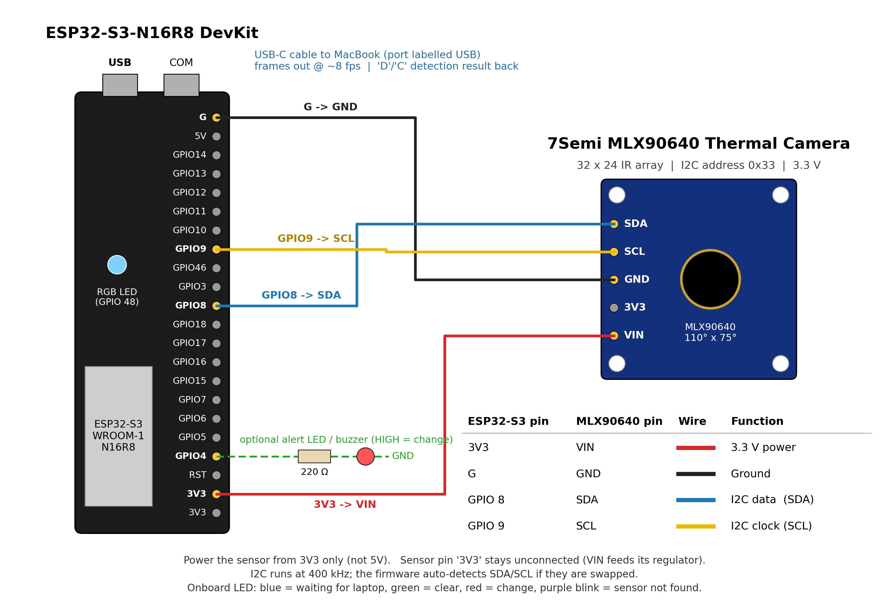

# Real-time hardware demo: MSCP-Mamba on an MLX90640 thermal camera

```
 MLX90640 (32x24 IR)  --I2C 400 kHz->  ESP32-S3-N16R8  --USB serial (or WiFi TCP)-->  MacBook (M4 GPU)
                                       ^  RGB LED / alert pin                          |  MSCP-Mamba
                                       '-------------- 'D' detected / 'C' clear -------'  + live window
```

- **ESP32-S3**: reads full temperature frames (~8 fps), sends them as 1554-byte CRC-checked
  packets, and shows the result it gets back on its LED: **red** = change detected,
  **green** = clear, **blue** = laptop not running, **purple blink** = sensor not found.
- **Laptop**: upsamples each 32x24 frame to the 240x320 grey format the model was
  trained on (CDnet2014 thermal), runs `cnn_mamba` on the Apple GPU, and displays
  thermal / probability / mask side by side with fps and latency.

Measured on a MacBook Air M4 (`--source sim`): **~115 ms inference, ~117 ms end-to-end
latency, 8.0 fps, 0 dropped frames**, so the laptop keeps up with the sensor.
The Mamba selective scan runs as a custom **Metal GPU kernel** (`host/model.py`).
It matches the notebook's PyTorch scan to ~1e-6 and cuts the scan from ~630 ms to ~20 ms.
Without it the model runs at ~720 ms/frame (1.4 fps).

## 1. Wiring



(Regenerate with `python3 docs/make_wiring_diagram.py`; an editable `docs/wiring_diagram.svg` is saved too.)

| MLX90640 breakout | ESP32-S3 pin |
|---|---|
| VIN / 3V3 | **3V3** (the 7Semi board is a 3.3 V part) |
| GND | GND |
| SDA | **GPIO 8** |
| SCL | **GPIO 9** |

Optional: an LED (with a 220 Ω resistor) or an active buzzer (through a transistor) on
**GPIO 4**. It goes HIGH while a change is detected.
Pins are `#define`s at the top of `firmware/thermal_streamer/thermal_streamer.ino`.
The onboard RGB LED is GPIO 48 (DevKitC-1 v1.0, most N16R8 boards). If yours does not
light up, set `RGB_LED_PIN` to 38.

## 2. Flash the ESP32-S3

**Arduino IDE**
1. Boards Manager: install **esp32 by Espressif** (3.x).
2. Library Manager: install **Adafruit MLX90640** (accept Adafruit BusIO).
3. Open `firmware/thermal_streamer/thermal_streamer.ino`.
4. Tools: Board **ESP32S3 Dev Module**, Flash Size **16MB**, PSRAM **OPI PSRAM**,
   USB CDC On Boot **Enabled**. Then Upload.
5. Plug the board into the Mac through the USB-C port labelled **USB** (or **OTG**), not
   **COM/UART**. With *USB CDC On Boot: Enabled*, the frames come out of the **USB** port
   only. To use the COM port instead, set *USB CDC On Boot* to **Disabled** and re-flash.
   If the first upload fails: hold **BOOT**, tap **RST**, release **BOOT**, upload again,
   then press **RST**.

**PlatformIO**: `cd firmware && pio run -t upload` (settings are in `platformio.ini`).

**WiFi (optional)**: copy `wifi_secrets.h.example` to `wifi_secrets.h` in the sketch
folder, fill in a 2.4 GHz network, and re-flash. The board then also serves frames on
`thermal-cam.local:3333`.

## 3. Run on the Mac

```bash
cd hardware/host
python3 -m venv .venv && source .venv/bin/activate
pip install -r requirements.txt
```

Copy the trained checkpoint from Google Drive (`MyDrive/mscp_mamba_balanced/best__cnn_mamba_balanced.pt`,
or `mscp_mamba_balanced_cdnet2014.pth`) into `hardware/host/weights/`. Then:

```bash
python run_realtime.py                                   # ESP32 over USB, port auto-detected
python run_realtime.py --source tcp:thermal-cam.local    # ESP32 over WiFi
python run_realtime.py --source sim                      # no hardware: simulated people
python run_realtime.py --weights none --source sim       # pipeline test without the checkpoint
```

Keys in the window: **`b` capture background** (press with the scene empty; removes the sensor's warm edges and static warm objects so only changes are detected), `x` clear it, `q` quit, `r` start/stop recording (saved to `recordings/*.npz`),
`s` snapshot, `f` cycle flip (use it if the image is mirrored), `n` auto/fixed
temperature normalisation, `[` / `]` threshold, `6` / `8` / `4` sensor refresh.
A recording can be replayed with `--source replay:recordings/rec_....npz`.

## 4. Things to know for the demo / report

- **Domain gap.** The model was trained on 320x240 CDnet thermal cameras. The MLX90640
  is 32x24, so the input is a 10x upsampled, blurry image. People and other warm objects
  show up as blobs, and how well the model segments them is not yet measured.
  Test it with the real sensor first. If the masks are weak, record scenes with `r`,
  label a few hundred frames, and fine-tune from the CDnet checkpoint. The notebook's
  training loop can be reused on the `.npz` frames.
- **Tuning knobs** if you get false alarms or misses: `--threshold` (default 0.9, as in the paper),
  `--min-area` (fraction of pixels that must be foreground, default 0.4%),
  `--norm fixed --tmin 20 --tmax 35` for a stable colour range in a known room.
- **Frame rate** is set by the sensor. At 16 Hz per sub-page the MLX90640 gives about
  8 full frames/s, and the model keeps up. The firmware also accepts `'3'` (32 Hz), which
  doubles the rate but adds noise, and inference (~115 ms) then becomes the bottleneck.
  The app always processes the newest frame, so latency stays low.
- The model is single-frame (no background model), as in the paper. "Change" means
  "foreground objects present in the ROI", as in CDnet's ground truth.
